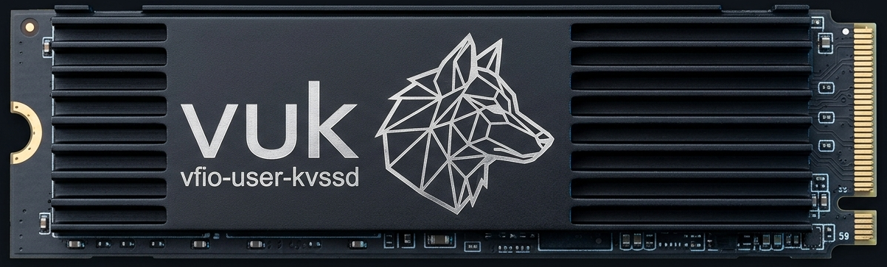

<p align="center">
  
</p>

# vfio-user-kvssd

[](https://github.com/safl/vfio-user-kvssd/actions/workflows/ci.yml)
[](LICENSE)
[](https://ziglang.org)
[](https://github.com/safl/vfio-user-kvssd/releases)

`vfu_kvssd` is an emulator of an **NVMe PCIe controller with a single
namespace supporting the Key-Value Command-Set (KVS)**, encapsulated in
a userspace process behind a vfio-user interface. Any vfio-user client
can drive it (the bundled `tests/` harness does so directly for unit
testing without QEMU in the loop).

A most useful client is **stock upstream QEMU (>= 10.1)**: attach
`vfu_kvssd` to it over a vfio-user socket and the guest operating system
sees an NVMe 2.0 controller with the KV Command Set, virtually
indistinguishable from a physical NVMe KV SSD.

It exists so the xNVMe CI can drop its dependency on the outdated
`SamsungDS/qemu` fork (the only QEMU build that carried KV support). With
`vfu_kvssd` xNVMe runs against latest stock QEMU; everything non-upstream
lives in this self-contained external process.

Written in C, built with **Zig** as the only toolchain, and shipped as a
single static x86_64/arm64 binary with no runtime dependencies.

## Quick start

```sh
# Build the device (needs Zig 0.16.x, nothing else).
zig build

# Run it on a socket.
zig-out/bin/vfu_kvssd --socket /tmp/vfu_kvssd.sock

# Or drive it end-to-end without QEMU (build, start, store/retrieve over KV):
tests/run_harness.sh zig-out/bin
```

Static, dependency-free binaries (cross-compiled from any host):

```sh
zig build -Dtarget=x86_64-linux-musl  -Dstatic=true -Doptimize=ReleaseSafe
zig build -Dtarget=aarch64-linux-musl -Dstatic=true -Doptimize=ReleaseSafe
```

## Attach to a QEMU guest

Needs QEMU >= 10.1 (Fedora 44 / Ubuntu 26.04 ship 10.2; Debian 13 and Ubuntu
24.04 do not). The guest RAM must be a **shared** memory backend so the device
can mmap it for DMA.

```sh
# 1. Start the device.
vfu_kvssd --socket /tmp/vfu_kvssd.sock

# 2. Boot the guest with the device attached as a vfio-user client.
qemu-system-x86_64 \
  -machine q35,accel=kvm,memory-backend=mem \
  -object memory-backend-memfd,id=mem,size=4G,share=on \
  -cpu host -smp 4 \
  <your guest kernel/disk options> \
  -device vfio-user-pci,socket=/tmp/vfu_kvssd.sock

# 3. In the guest the KV namespace appears as a generic char device, e.g.
#    /dev/ng0n1, ready for xNVMe KV tools (kvs, xnvme_tests_kvs).
```

The automated guest bring-up + xNVMe KV tests run under cijoe in CI; see
`cijoe/`.

## KV command set

I/O opcodes: STORE `0x01`, RETRIEVE `0x02`, LIST `0x06`, DELETE `0x10`,
EXIST `0x14`. Limits: key <= 16 bytes, value <= 4096 bytes. Backing store is
in-memory.

## Identity (PCI ID / SN / NQN)

The device hard-codes a single identity:

| Field   | Value                                |
|---------|--------------------------------------|
| PCI VID/DID  | `0x1b36` / `0x0010` (Red Hat / QEMU NVMe) |
| SN      | `VFUKVSSD0000000000000001`            |
| MN      | `vfio-user-kvssd`                    |
| SUBNQN  | `nqn.2025-11.dk.safl:vfu_kvssd`      |

**Multi-device caveat:** attaching more than one `vfu_kvssd` instance to the
same guest is **not supported yet**. The Linux NVMe driver de-duplicates
controllers by Serial Number and by NVM Subsystem NQN; a second instance with
the same SN/SUBNQN will fail to bind. Until the SN/SUBNQN become CLI knobs,
keep the deployment to one instance per guest.
